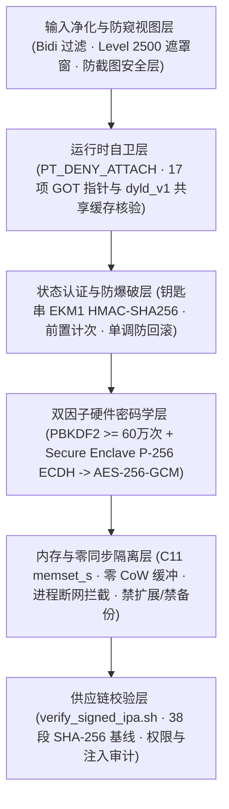

# Enkard 功能与安全架构详解

[← 返回项目主页 (README.md)](../README.md)

**Enkard**（v2.3.1）是一款专为 iPhone 本地自签场景设计的**纯离线、零云同步、绑定 Apple Secure Enclave 安全芯片**的原生银行卡保险库。本文档详细介绍 Enkard 的产品设计理念、日常管理功能、六层纵深安全架构以及平台物理边界。

---

## 目录

1. [设计理念：为什么做 Enkard？](#1-设计理念为什么做-enkard)
2. [核心功能详解](#2-核心功能详解)
3. [银行级+ 六层纵深安全架构](#3-银行级-六层纵深安全架构)
4. [构建、自签与完整性校验指南](#4-构建自签与完整性校验指南)
5. [版本演进与无缝升级](#5-版本演进与无缝升级)
6. [平台物理边界与使用须知](#6-平台物理边界与使用须知)

---

## 1. 设计理念：为什么做 Enkard？

在日常金融与海淘网购场景中，人们往往持有多张信用卡、借记卡与虚拟卡，卡号、有效期、CVV 安全码、交易/查询 PIN、账单地址、预留手机号后四位以及每月的账单日/还款日极易混淆。然而传统方案往往面临两难：

- **普通备忘录 / 相册拍卡**：一旦被同步到云端、被第三方 App 读取相册或手机解锁状态下被翻看，卡片信息即刻裸奔；
- **通用联网密码管理器**：依赖云端服务器、浏览器插件与复杂的第三方 SDK，攻击面远超本地需求。

**Enkard 的核心原则只有一条：把攻击面收敛到物理极限。**

- **纯 Apple 原生实现**：仅依赖 `SwiftUI`、`CryptoKit`、`SecureEnclave`、`CommonCrypto`、`Security` 与 `LocalAuthentication`，**零第三方依赖库**；
- **彻底断网与零同步**：源码不含任何联网业务代码，进程内注册全局断网拦截器，禁绝 iCloud、iCloud 钥匙串、系统备份、通用剪贴板与接力同步；
- **极简零隐私权限**：不申请相机、相册、定位、通讯录、麦克风或蓝牙权限（刻意移除 OCR 扫卡以彻底杜绝相机权限暴露）。

---

## 2. 核心功能详解

### 2.1 全维度卡片档案与智能识别
- **三大卡种分类**：支持 **信用卡**、**借记卡**、**虚拟卡** 分类管理。
- **卡组织自动识别与格式化**：输入卡号前缀即可自动识别 **银联 UnionPay**、**Visa**、**Mastercard**、**American Express（美国运通）**、**JCB** 与 **Discover**；自动适配运通卡 `4-6-5` 分组排版与 4 位 CVV 校验，并内置 **Luhn 校验位检测** 防止手误输错卡号。
- **完整金融字段**：支持记录发卡行、卡片别名、持卡人姓名、有效期（`MM/YY`）、CVV、PIN 码、账单地址、邮编、预留手机号后四位、授信额度及多行加密备注。
- **有效期与账单周期追踪**：信用卡支持设置 **每月账单日** 与 **还款日**，卡片临近到期（剩余 ≤ 2 个月）或已过期时自动在卡面与详情页给出醒目状态提示。

### 2.2 8 款金属质感卡面与高效检索
- 内置 **8 款暗色金属渐变卡面主题**：曜石黑金、深海鎏蓝、钛金深灰、翡翠暗绿、绯红丝绒、流光暗紫、极光青黛、玫瑰古铜，一眼区分不同银行与主力卡。
- 支持 **常用卡收藏置顶**、按卡种分类筛选，以及按银行名称、卡片别名、卡组织或卡号尾号实时本地检索。

### 2.3 防窥交互与本机定时自毁剪贴板
- **默认脱敏显示**：列表与详情页默认隐藏完整卡号（仅显示后四位，如 `•••• •••• •••• 8888`）、CVV 与 PIN，需主动点击方可临时展开，离开页面自动恢复掩码。
- **本机专属定时自毁剪贴板**：
  - 点击复制卡号、有效期或 CVV 时，强制写入 `UIPasteboard.general` 的 `.localOnly = true` 属性，**严禁通过 Apple 通用剪贴板（Universal Clipboard）广播至周边的 Mac 或 iPad**；
  - 同时设置 iOS 系统级 `.expirationDate`（支持 **10 秒 / 15 秒 / 30 秒 / 60 秒** 可选）与应用内倒计时双重清理——即便复制后直接划掉 Enkard 进程，系统也会在到期瞬间清空剪贴板；
  - **智能归属校验（`changeCount`）**：倒计时结束或锁屏清理时仅擦除 Enkard 写入的剪贴板内容，绝不误删你随后在其他 App 中复制的正常文本，并提供底部倒计时横幅「立即清空」按钮。

### 2.4 面容 ID、自动锁定与一键「紧急锁定」
- **生物识别快捷解锁**：支持面容 ID（Face ID）与触控 ID（Touch ID），生物识别密钥受系统生物特征集约束——一旦系统新增或变更面容/指纹，快捷密钥自动失效，强制回退主密码验证。
- **双重超时自动锁定**：
  - **切后台自动锁定**：支持「立即锁定（最安全）」、「离开 15 秒后（网购切屏推荐）」、「离开 30 秒后」、「离开 1 分钟后」；
  - **前台空闲自动锁定**：支持前台无触摸操作 **1 / 3 / 5 / 10 分钟** 后自动锁定并清空内存明文。
- **一键紧急锁定（防熟睡 / 过检 / 送修）**：首页导航栏与锁屏页均提供一键进入紧急锁定模式，瞬间从钥匙串擦除生物识别快捷密钥并收起输入焦点，此后**必须手动输入主密码**才能解锁。

### 2.5 纯离线加密迁移备份（`.enkard`）
- **独立高强恢复口令保护**：由于本机卡包绑定当前 iPhone 的 Secure Enclave 硬件私钥，换新机或重新签名前可手动导出 `.enkard` 加密备份文件。
- **内置 125-bit 随机恢复口令生成器**：一键生成 `5×5` 分组的 25 位 Crockford Base32 高熵恢复口令（剔除易混淆字符 `I/L/O/U`），抗离线超算暴力破解。
- **灵活导入与向下兼容**：支持 **合并导入（自动跳过同卡号）** 与 **覆盖替换** 两种模式，无缝兼容 `.enkard`、`.cardse` 与 `.cardvault` 备份格式；若检测到录屏/投屏则禁止导出，若误选 iCloud Drive 云目录则弹窗警示。

---

## 3. 银行级+ 六层纵深安全架构



### 第 1 层：全方位断网与零同步隔离
- **进程级网络熔断**：除源码零网络调用外，启动瞬间注册 `OfflineKillSwitchURLProtocol` 拦截一切非本地 URL 请求，并将 `URLCache` 内存/磁盘容量置为 `0`、Cookie 策略置为 `.never`、`Info.plist` 中 `NSAppTransportSecurity` 封锁本地局域网与任意连接。
- **五重零同步封锁**：
  1. **零 iCloud 钥匙串同步**：全部 Keychain 项显式固定 `kSecAttrSynchronizable = false` 及 `ThisDeviceOnly` 访问控制类；
  2. **零系统备份同步**：密文库目录、文件与安全偏好全部标记 `isExcludedFromBackup = true`（彻底弃用会被 iTunes/iCloud 备份带走的 `UserDefaults`）；
  3. **零跨设备接力与通用剪贴板**：显式拒绝 `NSUserActivity` 接力，剪贴板恒定 `localOnly = true`；
  4. **零第三方键盘与扩展注入**：`AppDelegate` 全局返回 `shouldAllowExtensionPointIdentifier -> false`，彻底阻断第三方输入法与系统扩展挂载；
  5. **零 AI 文本外发与词库残留**：关闭拼写检查、自动纠错、键盘词库学习，并显式禁用 iOS 18+ **Apple Intelligence 写作工具**（`.writingToolsBehavior(.disabled)`）。

### 第 2 层：Secure Enclave 硬件双因子信封加密
- **双因子密钥派生（`CARDSE_LOCAL_VAULT_V2`）**：
  - 因子 A（你所知）：主密码经 NFC 规范化后执行 `PBKDF2-HMAC-SHA256`（本机多轮中位数基准校准，迭代下限 **≥ 600,000 次**）；
  - 因子 B（你所持）：调用 iPhone **Secure Enclave 安全协处理器** 内不可导出的 P-256 硬件私钥与每库每次保存新生成的临时公钥执行硬件内 ECDH 密钥协商；
  - 两路熵源经 `HKDF-SHA256` 联合派生密钥加密密钥（KEK），再用 `AES-256-GCM` 封装随机生成的 256-bit 数据加密密钥（DEK）。**一旦密文离开这部物理手机的芯片，离线 GPU 集群暴力破解在数学上不可行。**
- **严格域分离与全字段 AAD 防嫁接**：本地库（`CARDSE_LOCAL_VAULT_V2`）与离线备份（`CARDSE_BACKUP_EXPORT_V2`）拥有独立魔数、HKDF `info` 标签与包裹上下文，严禁跨协议混用；数据密文的附加认证数据（AAD）完整绑定 `magic`、`version`、`vaultID`、`salt`、`ephemeralPublicKey` 及 `SHA256(wrappedDEK)`，任何密文头字段调包或跨文件嫁接均会在解密前触发 GCM 认证失败。
- **4 KB 定长块填充防体积侧信道**：明文载荷采用二进制定长头封装并填充对齐至 **4096 字节** 整数倍，外部观察者无法通过磁盘文件体积推算卡包中存放了几张银行卡。
- **抗虚高离线口令强度评估**：`PasswordPolicy` 针对全角标点/中文符号虚增字符池（如 `1234567！`）、常见泄露口令加标点变形、生日日期、手机号、连号与键盘序进行专项降权拦截，确保主密码（≥ 40 bit）与离线备份口令（≥ 65 bit）具备真实抗爆破熵值。
- **硬件级密码学擦除（Crypto-Shredding）**：手动销毁卡包或触发 15 次连续输错自毁时，直接销毁 Secure Enclave 中的硬件私钥令牌，使闪存底层任何历史磨损均衡残留块永久不可解密。

### 第 3 层：钥匙串 `EKM1` 状态防篡改、防爆破与防回滚
- **设备绑定钥匙串状态 HMAC 认证（`EKM1`）**：错误计数器、冷却状态、防回滚版本号与安全开关均由本机随机生成的 256-bit 钥匙串专属密钥按账户名域分离计算 `HMAC-SHA256` 认证标签，彻底封堵跨账户键值互换、负计数注入与删键重置攻击。
- **前置 Fail-Closed 计次与单调时钟冷却**：验证密码时**先将错误次数递增持久化写入钥匙串，再执行 PBKDF2 运算**（钥匙串写入失败则直接拒绝验证，杜绝断电/强杀绕过计次）；冷却计时联合绑定内核单调时钟 `CLOCK_MONOTONIC` 与内核启动会话 `kern.bootsessionuuid`，不受篡改系统时间或重启手机影响（5 次起递增冷却：30 秒 → 1 分钟 → 5 分钟 → 15 分钟 → 1 小时）。
- **非认证硬件瞬态故障防误毁**：严格区分密码/芯片认证失败（`authenticationFailed`）与锁屏后台瞬态不可用（如 `errSecInteractionNotAllowed`），绝不会因系统锁屏瞬态状态误计爆破次数、误触发 15 次自毁或误覆盖正在使用的芯片密钥。
- **双重防回滚水位线**：密文内嵌唯一 `vaultID` 与单调递增 `generation`（内置 `2^62` 安全上溢边界保护），与钥匙串 `EKM1` 认证水位线双向比对，拦截旧版密文文件覆盖回滚与异库替换。

### 第 4 层：自签运行时自卫与反 Hook / 反调试
- **内核级反调试**：Release 二进制在启动极早期通过原生 Mach-O 桩调用 XNU `ptrace(PT_DENY_ATTACH)` 置位内核进程标志 `P_LNOATTACH`，从内核层直接拒绝外部 `lldb` / `debugserver` 附加，并在运行期及每次回前台时持续执行 Fail-Closed `sysctl(P_TRACED)` 审计。
- **动态库注入与劫持段扫描**：遍历全进程已加载 Mach-O 镜像，对路径执行防 `..` 目录穿越规范化与系统路径白名单核验，并扫描全部镜像是否含有 `S_INTERPOSING` / `__interpose` 符号劫持段及 `DYLD_INSERT_LIBRARIES` 等危险环境变量。
- **19 项关键安全符号来源核验 + 17 项导入表（GOT）重绑定检测**：
  - 通过 `dlsym` + `dladdr` 核验密码学、随机数、钥匙串与系统调用等 **19 个核心函数** 的镜像归属；
  - 直接读取主程序自身 `__DATA_CONST,__got` 导入表中的 **17 个实际调用函数指针**，并通过原生桩结合 `dyld_cache_header`（完整兼容 `arm64e`、`arm64e.x1`、`arm64` 及多段只读映射头）结构合法性与缓存内可信系统镜像交叉验证，精准识破 `fishhook` GOT 重绑定、`dlsym` 欺骗与伪造共享缓存区间；
  - 一旦检测到异常环境，立即禁用生物识别快捷解锁并在锁屏与安全页给出醒目红色告警。

### 第 5 层：内存擦除、符号剥离、屏幕防泄露与反欺骗净化
- **C11 `memset_s` 强制清零与零 CoW 残留**：密码 UTF-8 缓冲、PBKDF2 派生输出、解封 DEK 与解密明文流均使用独立单持有者缓冲区并在 `defer` 中调用 C11 标准 `memset_s` 清零，防止编译器 `-O` 死存储消除（DSE）优化删掉擦除指令，也避免 Swift `Data` 切片写时复制（Copy-on-Write）遗留未擦除副本。
- **全量符号与反射名剥离**：Release 构建开启 `-disable-reflection-names` 与 `strip -rSTx`，剥离本地符号、Swift 符号及结构体属性反射元数据，大幅抬高静态逆向定位成本。
- **安全防截屏图层 + 超 Alert 级独立遮罩窗**：敏感卡片信息托管于系统安全渲染容器（截屏与录屏中自动呈现空白保护态）；同时配备层级高达 `UIWindow.Level.alert + 500` 的独立 UIKit 隐私遮罩窗口，在多任务切换缩略图、下拉通知栏及弹出系统确认框切后台瞬间严密遮蔽全部界面。
- **Unicode Bidi 双向字符反欺骗净化**：模型初始化与解码层统一剥离 `RLO`（`U+202E`）、`LRI`（`U+2066`）等双向覆盖/隔离字符、零宽字符及控制字符，杜绝导入恶意卡片数据实现文本视觉倒置欺骗。

### 第 6 层：自签供应链完整性校验（`verify_signed_ipa.sh`）
- `scripts/build_ipa.sh` 构建未签名包时同步提取主二进制关键只读代码/常量段及包内全部静态资源的 **38 项 SHA-256 哈希基线**（`dist/Enkard-integrity.sha256`）。
- 用户使用本地工具自签完成后，运行 `scripts/verify_signed_ipa.sh signed.ipa` 即可自动执行：
  1. 解压前扫描拦截 ZIP 符号链接（Symlink）穿越攻击；
  2. 核查包内是否存在任何注入的第三方 `.dylib` / `.framework` 或多余 PlugIns 扩展；
  3. 逐段比对签名后二进制的 `__TEXT` 代码段与静态资源哈希是否与官方构建基线 100% 一致；
  4. 审计签名描述文件（Entitlements），拦截恶意开启调试权限、iCloud 容器或跨应用共享 App Group / Keychain 组。

---

## 4. 构建、自签与完整性校验指南

### 方式一：直接下载 Release 未签名包自签（推荐）
1. 前往仓库 [Releases](https://github.com/Kianuni/Enkard/releases) 下载最新版本的 `Enkard-unsigned.ipa` 与 `Enkard-integrity.sha256`；
2. 核对下载文件的 SHA-256 摘要与 Release 页面公布值一致；
3. 使用你本人的 Apple ID / 开发者证书通过 **Xcode** 或 **Sideloadly（本地签名模式，关闭一切 Tweak/Dylib 注入选项）** 完成签名；
4. 安装前可在电脑端执行校验脚本确认签名工具未篡改二进制：
   ```bash
   chmod +x scripts/verify_signed_ipa.sh
   ./scripts/verify_signed_ipa.sh /path/to/signed.ipa
   ```
5. 安装到 iPhone 后，建议前往 **「设置 → App → Enkard → 无线数据」** 选择 **「关闭」**，叠加 iOS 系统内核级零流量防护。

### 方式二：从源码本地编译
环境要求：macOS + Xcode（含 iOS SDK）。
```bash
git clone https://github.com/Kianuni/Enkard.git
cd Enkard
chmod +x scripts/build_ipa.sh scripts/verify_signed_ipa.sh
./scripts/build_ipa.sh
```
编译产物将输出至 `dist/Enkard-unsigned.ipa` 与 `dist/Enkard-integrity.sha256`。

---

## 5. 版本演进与无缝升级

- 自 `v2.2.0` 起应用正式定名为 **Enkard**（原名 `CardSe`）。
- **零损无缝升级**：Bundle Identifier（`com.local.cardse.app`）、Keychain 服务标识、Secure Enclave 密钥标签与加密存储路径均保持完全兼容。使用同一 Apple 账号/签名证书直接覆盖安装新版本，即可直接用原主密码或面容 ID 解锁既有卡包，无需重新录入。
- **备份扩展名兼容**：新导出的离线备份默认采用 `.enkard` 扩展名；历史导出的 `.cardse` 与 `.cardvault` 加密备份依然可直接导入。

---

## 6. 平台物理边界与使用须知

Enkard 坚持诚实透明的安全工程原则，请在使用前知悉以下操作系统与硬件客观边界：

1. **切勿关闭 iPhone 系统锁屏密码**：Enkard 的 Secure Enclave 硬件私钥与生物识别密钥均采用 `WhenPasscodeSetThisDeviceOnly` 硬件保护策略。如果你在系统设置中彻底关闭 iPhone 锁屏密码，iOS 安全芯片会依法永久销毁相关硬件密钥，导致本机卡包无法再解密（如需重置锁屏密码或送修手机，请务必提前导出 `.enkard` 离线备份）。
2. **仅在未越狱设备上使用**：进程内反调试与反注入检测能够大幅抬高攻击门槛并及时告警，但若设备本身已被越狱（内核/Root 权限失陷）或 IPA 在重签阶段被恶意篡改代码，任何用户态进程都无法在失陷内核上提供绝对保证。请始终在未越狱 iPhone 上配合 `verify_signed_ipa.sh` 使用。
3. **Swift / UIKit 运行时内存管理客观限制**：Enkard 对密钥材料、PBKDF2 输出、解封 DEK 与解密字节缓冲均执行了 `SymmetricKey` 托管与 C11 `memset_s` 强制清零，但用户在系统 `UITextField` 输入过程中的历史 `String` 内部缓冲副本由 iOS 系统框架管理，无法在用户态实现 100% 物理页级擦除。
4. **粘贴支付时的外部输入法风险**：在浏览器或购物 App 中粘贴卡号/CVV 结账时，建议同样切换至 iOS 系统原生键盘，并在粘贴完成后点击提醒或返回清空剪贴板。

---

[← 返回项目主页 (README.md)](../README.md)
