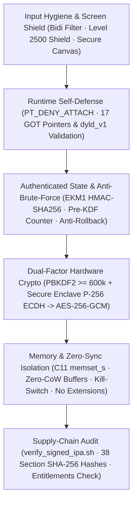

# Enkard — Full Feature & Security Architecture Guide

[← Back to README (README_EN.md)](../README_EN.md) · [🇨🇳 简体中文详情 (DETAILS.md)](DETAILS.md)

**Enkard** (`v2.4.0`) is a native iOS bank card vault built for local sideloading and self-signing—**100% offline, zero cloud sync, and cryptographically bound to the Apple Secure Enclave**. This document details Enkard's design philosophy, daily card management capabilities, six-layer defense-in-depth security architecture, and honest platform boundaries.

---

## Table of Contents

1. [Design Philosophy: Why Enkard?](#1-design-philosophy-why-enkard)
2. [Core Features](#2-core-features)
3. [Bank-Grade+ Six-Layer Defense-in-Depth Architecture](#3-bank-grade-six-layer-defense-in-depth-architecture)
4. [Build, Self-Signing & Integrity Verification](#4-build-self-signing--integrity-verification)
5. [Version Evolution & Seamless Upgrades](#5-version-evolution--seamless-upgrades)
6. [Platform Physical Boundaries & Operational Notes](#6-platform-physical-boundaries--operational-notes)

---

## 1. Design Philosophy: Why Enkard?

When managing multiple credit, debit, and virtual cards for online checkout or cross-border shopping, recalling PANs, expiry dates, CVV codes, billing addresses, registered phone suffixes, and statement/due dates quickly becomes cumbersome. Conventional tools force an undesirable trade-off:

- **Notes / Photos of Physical Cards**: Once synced to iCloud Photos/Notes, read by third-party apps with photo access, or viewed on an unlocked phone, sensitive card numbers are exposed in plaintext;
- **Cloud Password Managers**: Depend on remote servers, browser extensions, and large third-party SDK footprints far broader than an offline card vault needs.

**Enkard follows one core principle: shrink the attack surface to its physical minimum.**

- **Pure Apple Native Stack**: Built strictly with `SwiftUI`, `CryptoKit`, `SecureEnclave`, `CommonCrypto`, `Security`, and `LocalAuthentication`—**zero third-party dependencies**;
- **Absolute Network Lockdown & Zero Sync**: Contains zero networking business logic, installs a process-wide network kill-switch at launch, and explicitly disables iCloud, iCloud Keychain, system backups, Universal Clipboard, and Handoff;
- **Zero Privacy Permissions**: Requests no camera, photo library, location, contacts, microphone, or Bluetooth permissions (OCR card scanning was intentionally omitted to avoid exposing camera access).

---

## 2. Core Features

### 2.1 Comprehensive Card Records & Smart Detection
- **Three Card Categories**: Organize **Credit Cards**, **Debit Cards**, and **Virtual Cards**.
- **Automatic Network Identification & Formatting**: Detects **UnionPay**, **Visa**, **Mastercard**, **American Express**, **JCB**, and **Discover** directly from number prefixes; automatically applies AMEX `4-6-5` grouping and 4-digit CVV expectations, plus real-time **Luhn check-digit validation** to catch typos.
- **Complete Financial Metadata**: Store issuing bank, card nickname, cardholder name, expiry (`MM/YY`), CVV, legacy PIN (with deprecation warning and one-tap removal), billing address, postal/ZIP code, registered phone last 4 digits, credit limit, and multiline encrypted notes.
- **Expiry & Statement Tracking**: Record monthly **statement day** and **due day**; cards within 2 months of expiration or already expired automatically display prominent status badges.

### 2.2 Metallic Card Themes, Bilingual UI & Instant Search
- **Complete Bilingual Support (`English` / `简体中文`)**: Switch seamlessly between **Follow System**, **简体中文**, and **English** across onboarding, lock screen, vault, security posture telemetry, password strength feedback, and system `InfoPlist` Face ID prompts. Language selection is stored inside the `EKM1` HMAC-authenticated, device-only Keychain record—never in `UserDefaults`.
- **8 Dark Metallic Finishes**: Obsidian Gold, Midnight Blue, Titanium Slate, Emerald Jade, Crimson Ruby, Royal Violet, Aurora Teal, and Rose Bronze.
- **Pin & Search**: Pin favorite cards to the top, filter by category/network, and search locally across bank names, aliases, last-4 digits, cardholder names, and both English and Chinese network keywords.

### 2.3 Privacy-First UX & Self-Destructing Local Clipboard
- **Masked by Default**: Card lists and detail rows mask full numbers (showing only the last 4 digits, e.g. `•••• •••• •••• 8888`), CVV, and sensitive notes until explicitly revealed inside a screenshot-protected container, automatically re-masking after 10s or upon leaving the screen.
- **Local-Only Auto-Expiring Clipboard**:
  - Copying any field sets `UIPasteboard.general` with `.localOnly = true`, **blocking Apple Universal Clipboard broadcast to nearby Macs or iPads**;
  - Sets both system-enforced `.expirationDate` (**10s / 15s / 30s / 60s**) and an in-app countdown banner—even if Enkard is force-quit immediately after copying, iOS purges the pasteboard item at expiration;
  - **Ownership Tracking (`changeCount`)**: Only clears clipboard contents written by Enkard, never erasing unrelated text you later copy in another app.

### 2.4 Face ID, Dual Auto-Lock & 1-Tap Emergency Lockdown
- **Biometric Quick Unlock**: Supports Face ID, Touch ID, and Optic ID bound to `.biometryCurrentSet`—adding or altering enrolled biometrics on the device automatically invalidates the shortcut key and requires master password re-entry.
- **Dual Auto-Lock Timers**:
  - **Background Auto-Lock**: Configurable for *Immediately (Most Secure)*, *After 15s (Recommended for Checkout)*, *After 30s*, or *After 1 min*;
  - **Foreground Idle Lock**: Automatically locks and zeroes memory after **1 / 3 / 5 / 10 minutes** of inactivity.
- **1-Tap Emergency Lockdown**: Available directly on both the home toolbar and lock screen. Purges the biometric key from Keychain, drops active input focus, wipes the clipboard, and enforces master-password-only authentication for the next unlock.

### 2.5 Offline Encrypted Migration Backups (`.enkard`)
- **Portable Passphrase Protection**: Because local vaults are cryptographically tied to your current iPhone's Secure Enclave, export an `.enkard` backup before upgrading devices or re-signing with a new team ID.
- **Built-In 125-bit Passphrase Generator**: Generates a 25-character (`5×5`) Crockford Base32 recovery passphrase (omitting ambiguous `I/L/O/U`) immune to offline brute-force cracking.
- **Flexible Import & Warnings**: Supports **Merge** (skipping duplicate card numbers) and **Replace All** modes, imports legacy `.cardse` and `.cardvault` backups, blocks export during active screen recording, and alerts immediately if a path inside iCloud Drive is chosen.

---

## 3. Bank-Grade+ Six-Layer Defense-in-Depth Architecture



### Layer 1: Total Network Lockdown & Zero-Sync Isolation
- **Process-Level Network Circuit Breaker**: Beyond zero networking code, launch immediately registers `OfflineKillSwitchURLProtocol` to reject any non-file URL request, zeroes `URLCache`, disables `HTTPCookieStorage`, and restricts `NSAppTransportSecurity` in `Info.plist`.
- **Five-Fold Zero-Sync Controls**:
  1. **Zero iCloud Keychain Sync**: Every Keychain item explicitly specifies `kSecAttrSynchronizable = false` and `ThisDeviceOnly` accessibility;
  2. **Zero System Backup Exposure**: Vault directories, files, and preferences are marked `isExcludedFromBackup = true` (avoiding `UserDefaults` completely so preferences never enter iTunes/iCloud backups);
  3. **Zero Handoff & Universal Clipboard**: Rejects `NSUserActivity` continuity and pins pasteboard items to `.localOnly = true`;
  4. **Zero 3rd-Party Keyboards & Extensions**: `AppDelegate` rejects custom keyboards, AutoFill providers, share/action/broadcast/widget extensions via `shouldAllowExtensionPointIdentifier`;
  5. **Zero AI Writing Tools & Lexicon Learning**: Disables autocorrect, spell check, predictive text, and iOS 18+ Apple Intelligence Writing Tools (`.writingToolsBehavior(.disabled)`).
- **POSIX Non-Symlink & Anti-Sparse-Bomb File Boundary (`SafeVaultFileIO`)**: Vault directory creation, reads, atomic writes, and secure shredding verify every ancestor and leaf node via `lstat` + `O_DIRECTORY | O_NOFOLLOW` descriptor anchoring (`fstatat(AT_SYMLINK_NOFOLLOW)`, `openat(O_NOFOLLOW | O_CLOEXEC | O_NONBLOCK)`, `renameat`, `unlinkat`) and a **40 MB hard size ceiling**, preserving `NSFileProtectionComplete` lock-screen protection while thwarting cross-container symlink traversal, FIFO hangs, and sparse-file OOM bombs.

### Layer 2: Secure Enclave Dual-Factor Envelope Encryption
- **Dual-Factor KEK (`CARDSE_LOCAL_VAULT_V2`)**:
  - **Factor A (What you know)**: Master password normalized via Unicode NFC and stretched with `PBKDF2-HMAC-SHA256` (dynamically benchmarked median calibration, minimum **600,000 rounds**);
  - **Factor B (What you have)**: Non-exportable P-256 private key inside the iPhone **Secure Enclave** performing ECDH key agreement against an ephemeral P-256 key generated per vault/rotation;
  - Both secrets combine via `HKDF-SHA256` to derive the KEK wrapping a random 256-bit DEK (`AES-256-GCM`). **Ciphertext copied off the physical device cannot be cracked offline by GPU clusters.**
- **Strict Domain Separation & Full-Header AAD**: Local vaults (`CARDSE_LOCAL_VAULT_V2`) and portable backups (`CARDSE_BACKUP_EXPORT_V2`) use disjoint magic headers and HKDF `info` contexts. Payload GCM AAD authenticates `magic`, `version`, `vaultID`, `kdfIterations`, `salt`, `ephemeralPublicKey`, and `SHA256(wrappedDEK)`, blocking header splicing and cross-vault swaps.
- **4 KB Block Padding**: Plaintext payloads are length-framed and zero-padded to **4096-byte multiples** (with strict zero-byte validation on decryption), concealing card counts from file-size observers.
- **Anti-Inflation Password Policy (`PasswordPolicy`)**: Discounts full-width CJK punctuation padding (`1234567！`), dictionary/pinyin/leet patterns, LZ77 repeated blocks (`Ab1!Ab1!`), dates, phone numbers, and keyboard walks, enforcing ≥ 40 bits (8+ chars) for master passwords and ≥ 65 bits (12+ chars) for custom backups.
- **Hardware Crypto-Shredding**: Erasing the vault or hitting the optional 15-attempt threshold deletes the Secure Enclave hardware token, rendering any flash wear-leveling remnants permanently undecryptable.

### Layer 3: `EKM1` Authenticated Keychain State, Throttling & Anti-Rollback
- **Keychain State MAC (`EKM1`)**: Failed attempt counters, backoff timers, anti-rollback identity watermarks, and user preferences are authenticated using a device-bound 256-bit Keychain HMAC key (`HMAC-SHA256`) domain-separated by exact account name, defeating JSON tampering, cross-account replay, and MAC stripping.
- **Pre-KDF Fail-Closed Counter & Monotonic Cooldown**: Increments and persists the attempt counter *before* executing PBKDF2 (aborting if Keychain is unavailable). Cooldown timers bind to `CLOCK_MONOTONIC` and `kern.bootsessionuuid`, immune to wall-clock rollback or device reboots (30s → 1m → 5m → 15m → 1h starting at failure 5).
- **Transient Hardware Fault Isolation**: Distinguishes genuine password mismatch (`authenticationFailed`) from transient locked-device Keychain/SEP errors (`errSecInteractionNotAllowed`), rolling back the pre-KDF increment so background wakes never trigger false wipes.
- **Dual Anti-Rollback Watermark**: Encrypted payloads embed `vaultID` and monotonic `generation` (capped below `2^62`), cross-checked against Keychain `EKM1` watermarks to detect file rollbacks or foreign vault substitutions.

### Layer 4: Runtime Self-Defense & Anti-Hook / Anti-Debug
- **Kernel Anti-Debug**: Release builds execute `ptrace(PT_DENY_ATTACH)` via a direct Mach-O stub at launch (`P_LNOATTACH`), blocking `lldb`/`debugserver` attachment even on personal dev certs (`get-task-allow=true`), paired with continuous fail-closed `sysctl(P_TRACED)` checks.
- **Dynamic Library & Interpose Auditing**: Enumerates every loaded Mach-O image, validates normalized paths against traversal spoofing and system allowlists, and scans load commands for `S_INTERPOSING` / `__interpose` sections and `DYLD_INSERT_LIBRARIES`.
- **19 Critical Symbol Audits + 17 GOT Pointer Checks**:
  - Cross-checks image ownership via `dlsym` + `dladdr` across **19 core security/crypto functions**;
  - Reads **17 live function pointers** directly from the app's own `__DATA_CONST,__got` import table and validates them against a structurally verified `dyld_cache_header` (`dyld_v1` across `arm64e`, `arm64e.x1`, `arm64`, RO multi-mappings, non-zero UUID, and trusted in-cache image cross-verification), catching `fishhook` GOT rebinding and forged shared-cache ranges.

### Layer 5: Memory Zeroization, Symbol Stripping & Screen Shielding
- **C11 `memset_s` & Zero-CoW Buffers**: Password UTF-8 buffers, PBKDF2 output, unwrapped DEKs, and decrypted plaintext streams are copied into single-owner buffers and scrubbed in `defer` via `memset_s` (immune to dead-store elimination).
- **Full Symbol & Reflection Stripping**: Release builds enable `-disable-reflection-names` and `strip -rSTx`, stripping local Swift symbols and runtime metadata.
- **Secure Canvas + Level-2500 Shield Window**: Card visuals and secret labels render inside iOS's secure `UITextField` canvas layer (appearing blank in screenshots/recordings), while an independent `UIWindow` above `UIWindow.Level.alert + 500` conceals the entire app synchronously on `willResignActive` and during screen capture.
- **Unicode Bidi Anti-Spoofing**: `BankCard` initialization and JSON decoding strip bidirectional override/isolate scalars (`U+202E` RLO, `U+2066` LRI, etc.), zero-width formatters, and C0/C1 control characters.

### Layer 6: Supply-Chain Re-Signing Verification (`verify_signed_ipa.sh`)
- `scripts/build_ipa.sh` records **38 SHA-256 section hashes** across Mach-O `__TEXT` / `__DATA_CONST` / `__DATA` segments into `dist/Enkard-integrity.sha256`.
- Running `./scripts/verify_signed_ipa.sh /path/to/signed.ipa` inspects ZIP central directories prior to extraction (blocking Zip-Slip and ZIP symlinks), verifies single-slice `arm64`, enforces strict file and system-dylib allowlists, confirms symbol stripping, compares all 38 Mach-O sections 1-to-1, and audits signing entitlements against iCloud, push, debug, or shared App Group/Keychain injection.

---

## 4. Build, Self-Signing & Integrity Verification

### Option 1: Download Pre-Built Unsigned IPA (Recommended)
1. Download `Enkard-unsigned.ipa` and `Enkard-integrity.sha256` from [GitHub Releases](https://github.com/Kianuni/Enkard/releases).
2. Verify file SHA-256 digests match the published release notes.
3. Sign locally using **Xcode** or **Sideloadly (Local mode, all tweak/dylib injection disabled)**.
4. Verify integrity prior to installing:
   ```bash
   chmod +x scripts/verify_signed_ipa.sh
   ./scripts/verify_signed_ipa.sh /path/to/signed.ipa
   ```
5. After installing on iPhone, optionally open **Settings → Apps → Enkard → Wireless Data → Off** for an OS kernel-level zero-traffic firewall.

### Option 2: Build from Source
Requirements: macOS + Xcode with iOS SDK.
```bash
git clone https://github.com/Kianuni/Enkard.git
cd Enkard
chmod +x scripts/build_ipa.sh scripts/verify_signed_ipa.sh
./scripts/build_ipa.sh
```
Outputs are written to `dist/Enkard-unsigned.ipa` and `dist/Enkard-integrity.sha256`.

---

## 5. Version Evolution & Seamless Upgrades

- Renamed to **Enkard** in `v2.2.0` (formerly `CardSe`); **bilingual edition** introduced in `v2.4.0`.
- **Zero-Loss Upgrade**: Bundle ID (`com.local.cardse.app`), Keychain services, Secure Enclave key accounts, and storage paths remain unchanged. Overwrite-install using the same signing certificate to retain all existing cards, preferences, and biometric enrollment seamlessly.
- **Backward-Compatible Backups**: Exports use `.enkard`; historical `.cardse` and `.cardvault` backups remain directly importable.

---

## 6. Platform Physical Boundaries & Operational Notes

Enkard adheres to transparent security engineering regarding OS and hardware constraints:

1. **Keep Device Passcode Enabled**: Keys rely on `WhenPasscodeSetThisDeviceOnly`. Turning off your iPhone passcode instructs iOS to purge Secure Enclave keys permanently—export an `.enkard` offline backup beforehand if changing security settings.
2. **Use Only on Non-Jailbroken Devices**: In-process anti-debug and anti-hook checks detect tampering in user space, but a compromised kernel on a jailbroken device or a modified IPA binary can subvert user-mode defenses. Always verify signed IPAs with `verify_signed_ipa.sh`.
3. **Swift / UIKit Input Buffering**: While Enkard zeroes cryptographic material and UTF-8 buffers with `memset_s`, transient `String` buffers during active typing inside `UITextField` are managed by UIKit.
4. **Use Native Keyboard When Pasting**: When pasting card details into browsers or shopping apps, stay on Apple's native keyboard and tap **Clear Now** (or lock the screen) once checkout finishes.

---

[← Back to README (README_EN.md)](../README_EN.md)
